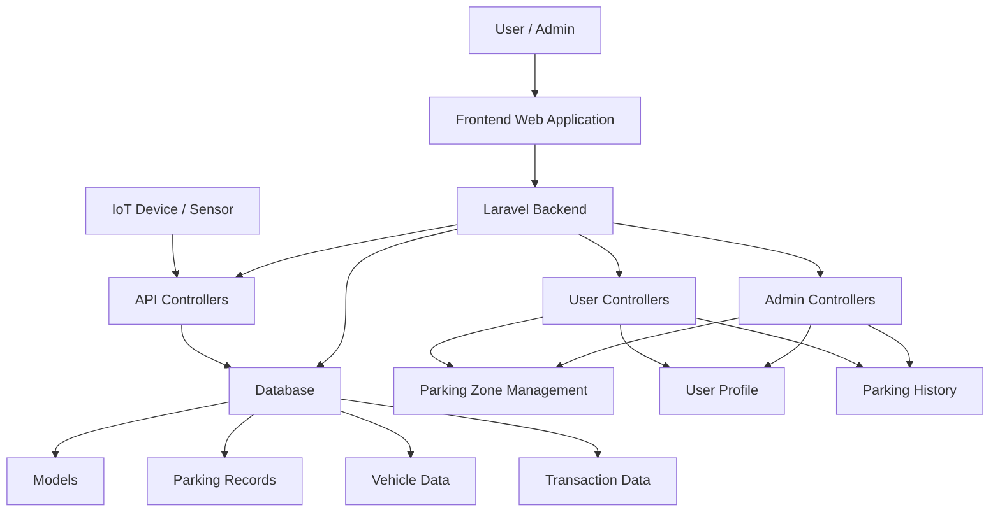

# 🚗💡 SPARKING | ParkirCerdasBatam

## Analysis Parkir dan Kondisi Kepadatan Jalan Menggunakan AI dan IoT

---

## 📖 Description

**Sparking (ParkirCerdasBatam)** is a smart web-based parking management and analytics system that leverages **Internet of Things (IoT)** and **Artificial Intelligence (AI)** technologies.

This system was developed in response to a common issue experienced around the **Politeknik Negeri Batam** area, where drivers often face difficulties finding available parking spaces during peak hours, campus activities, or special events. These situations frequently lead to unnecessary circulation inside parking areas, traffic congestion, wasted fuel, and inefficient parking management.

To address these challenges, Sparking provides a smarter and more efficient approach to parking management by delivering **real-time parking slot monitoring**, **vehicle occupancy tracking**, and **parking utilization analytics**.

The system supports two main actors:

- **Admin**
- **User**

### Main Features

✅ Real-time Parking Slot Monitoring  
✅ Parking Zone Management  
✅ Parking Utilization Analytics  
✅ Vehicle Monitoring  
✅ User Authentication & Authorization  
✅ Parking History Tracking  
✅ AI-Based Data Analysis  
✅ IoT-Based Parking Monitoring Integration

Sparking is a continuation and enhancement of the previous project called **SIPPP (Sistem Informasi Pemantauan Parkir Polibatam)**.

While SIPPP focused on:

- User Registration
- Login & Logout
- Vehicle Monitoring
- Password Management

Sparking expands and improves these capabilities by introducing:

- Enhanced Authentication System
- Real-time Parking Slot Monitoring
- Parking Occupancy Visualization
- Data Analytics Dashboard
- AI-powered Parking Analysis
- IoT Device Integration

---

## 🌐 Live Demo

🔗 **Application URL**

https://sparking-polibatam.up.railway.app/

---

## 🖼️ Project Poster

   

---

## 👥 Team

### Project Manager

**Miratul Khusna Mufida, S.ST., M.Sc**

Responsibilities:

- Project Supervision
- Research Guidance
- Evaluation & Validation
- Project Consultation

---

### Team Leader

**3312301097 – Muhammad Adib Fakhri Siregar**

Responsibilities:

- Frontend Development
- Backend Development
- System Architecture Design
- Database Design
- Team Coordination

---

### Team Member

**3312301025 – Nayla Nabillah Arishima**

Responsibilities:

- Documentation
- Requirement Analysis
- System Documentation
- Final Report Preparation

---

### Team Member

**3312301046 – Meizua Muhsana**

Responsibilities:

- Documentation
- System Testing
- User Acceptance Testing (UAT)
- Final Report Preparation

---

### Team Member

**3312311133 – Grey Ari Daniel Simatupang**

Responsibilities:

- Backend Development
- AI Integration
- IoT Integration
- Feature Development
- Deployment
- Server Configuration
- Hosting Management
- System Maintenance

---

## ✨ Features

### 🚘 Parking Monitoring

- Real-time parking occupancy monitoring
- Slot availability visualization
- Parking status updates from IoT sensors
- Parking area monitoring dashboard

### 🗺️ Parking Zone Management

- Zone creation and management
- Parking slot configuration
- Sub-zone management
- Availability management

### 👤 User Management

- User registration
- Secure authentication
- Login and logout
- Password recovery
- User profile management

### 📊 Analytics & Reporting

- Parking utilization analysis
- Occupancy statistics
- Peak-hour detection
- Historical parking reports
- Data visualization dashboard

### 🤖 AI & IoT Integration

- Occupancy data collection
- Real-time parking status updates
- Smart parking analytics
- Traffic density analysis support

### 🛠️ Administration

- Admin dashboard
- User management
- Zone management
- Slot management
- Activity monitoring

---

## 🛠️ Technology Stack

### Backend

- PHP
- Laravel

### Frontend

- JavaScript
- Blade Template Engine

### UI Framework & Styling

- Tailwind CSS
- DaisyUI
- Flowbite

### Database

- MySQL

### Build Tools

- Vite

### HTTP Communication

- Axios

### Other Technologies

- Internet of Things (IoT)
- Artificial Intelligence (AI)

---

## 📦 Installation Guide

### 1. Clone Repository

```bash
git clone https://github.com/Adib-F/Sparking.git
```

---

### 2. Enter Project Directory

```bash
cd Smart_parking
```

---

### 3. Install Dependencies

Install PHP dependencies:

```bash
composer install
```

Install Node.js dependencies:

```bash
npm install
```

---

### 4. Update Composer Autoload

```bash
composer dump-autoload
```

---

### 5. Configure Environment File

Rename:

```bash
.env-example
```

to:

```bash
.env
```

Linux/MacOS:

```bash
mv .env-example .env
```

Windows:

```bash
rename .env-example .env
```

---

### 6. Configure Database

Update database configuration in `.env`

```env
DB_CONNECTION=mysql
DB_HOST=127.0.0.1
DB_PORT=3306
DB_DATABASE=sparking_db
DB_USERNAME=root
DB_PASSWORD=
```

---

### 7. Generate Application Key

```bash
php artisan key:generate
```

---

### 8. Run Database Migration

```bash
php artisan migrate
```

Optional:

```bash
php artisan db:seed
```

---

### 9. Create Storage Link

```bash
php artisan storage:link
```

---

### 10. Launch Application

Run Laravel Development Server:

```bash
php artisan serve
```

Run Vite Development Server:

```bash
npm run dev
```

Application will be accessible at:

```text
http://127.0.0.1:8000
```

---

## 📂 Project Structure

```text
Smart_parking/
│
├── app/
│   ├── Http/
│   │   ├── Controllers/
│   │   │   ├── Admin/
│   │   │   └── Api/
│   │   └── Middleware/
│   ├── Models/
│   ├── Notifications/
│   └── Providers/
│
├── bootstrap/
├── config/
│
├── database/
│   ├── factories/
│   ├── migrations/
│   └── seeders/
│
├── public/
│
├── resources/
│   ├── css/
│   ├── js/
│   └── views/
│       ├── admin/
│       ├── component/
│       └── email/
│
├── routes/
├── storage/
├── vendor/
│
├── artisan
├── composer.json
├── package.json
├── vite.config.js
└── .env.example
```

---

## 📊 System Architecture



---

## 🔐 Authentication Features

- User Registration
- Login System
- Logout System
- Forgot Password
- Password Reset
- Role-Based Access Management
- Secure Authentication

---

## 📈 Key Modules

### Admin Module

- Dashboard
- Parking Slot Management
- Zone Management
- User Management
- Analytics & Reports
- Transaction Monitoring

### User Module

- Parking Monitoring
- Vehicle Monitoring
- Profile Management
- Parking History

### Analytics Module

- Occupancy Analysis
- Utilization Statistics
- Historical Analysis
- Peak Hour Analysis

### IoT Module

- Sensor Integration
- Parking Detection
- Real-time Data Synchronization

---

## 🚀 Future Development

- Mobile Application
- QR Code Parking Access
- Smart Reservation System
- Online Payment Gateway
- License Plate Recognition (LPR)
- Predictive Parking Availability
- AI Traffic Congestion Analysis
- Smart Notification System

---

## 🤝 Contributing

Contributions are welcome.

1. Fork this repository

2. Create feature branch

```bash
git checkout -b feature/new-feature
```

3. Commit your changes

```bash
git commit -m "Add new feature"
```

4. Push branch

```bash
git push origin feature/new-feature
```

5. Open Pull Request

---

## 📄 License

This project was developed as part of the **Project Based Learning (PBL)** program at **Politeknik Negeri Batam**.

For academic and educational purposes.

---

## ❤️ Acknowledgement

Special thanks to:

- Politeknik Negeri Batam
- Project Based Learning (PBL) Program
- Supervisor and Project Manager
- All Team Members of Sparking Project

---

**SPARKING | ParkirCerdasBatam**  
*Smart Parking Management, Analytics, AI & IoT Integration*
